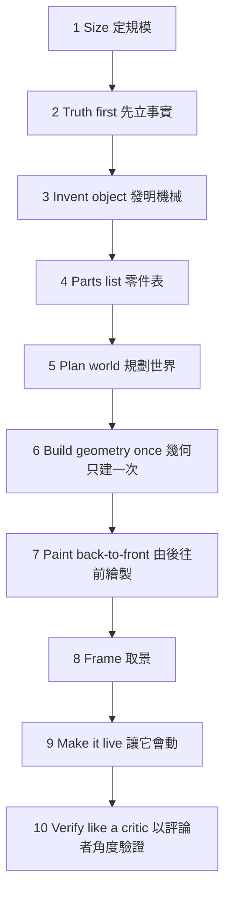

# anatomy 技術分析報告

> 標的：`https://github.com/wheresryan22/anatomy`（MIT、主要語言 JavaScript、14,187★／1,074 forks、41 open issues，建於 2026-10-08、2026-10-15 最後 push）
> 本報告為 R1 首輪產出。資料來源：repo 內一手文件（README 25.8KB／SKILL.md 31.6KB／CHANGELOG／evals.json／agents/openai.yaml）＋ GitHub API metadata ＋ 作者官網（標為作者自陳）。GitHub 一周热点 135 期影片之逐字稿不可得（YouTube transcripts disabled）。

---

## 1. 這個技術解決什麼問題？

一句話：**把抽象的技術概念「發明成一台作動即概念的真實機械」，並輸出成可互動的等角（isometric）技術圖**——讓讀者看機械怎麼動，就理解概念怎麼運作。

它與既有圖解手段的差異：

| 既有手段 | 得到什麼 | 缺什麼 | anatomy 的差異 |
|---|---|---|---|
| 文字 | 精確命題 | 空間與作動關係難以承載 | 用機械的部件與動作承載關係 |
| 方塊圖／流程圖 | 拓撲關係清楚 | 只剩符號，與「實體怎麼運作」斷開 | 發明一台有零件、會動的機械 |
| 一般 AI 生圖 | 視覺好看 | 不精確、不可編輯、不可驗證 | 以程式確定性生成 SVG，可檢視、可修改、可稽核 |
| 專業 3D 建模 | 幾何真實 | 慢、貴、需人工 | 由 agent 依 SKILL 工作流產出，成品即原始碼 |

問題描述的模糊之處：

- **「真實機械」的定義。** 它指的不是既有機器的再現或工程圖，而是為解釋概念而**發明**的機械（測試台、儀表、鎖、分信桌）。若預期「某真實機器的精確還原」，此技術不提供。
- **「互動式」的範圍。** 互動來自三型輸出中的 SVG+WebGL 層與 3D（beta）旋轉重投影；純 SVG 的核心輸出本身是靜態圖。若預期任意點擊／hover 的 UI 互動，範圍不符。

---

## 2. 這個問題為什麼會發生？（背景）

> 區分「文章明確提到」與「通用技術背景」。

### 2.1 技術概念難以視覺化的結構性原因（通用技術背景）

| 成因 | 說明 |
|---|---|
| 概念的形狀不是線性的 | 概念多為拓撲或時序（什麼接到什麼、先後發生什麼），而文字是線性媒體，難以承載並行與空間關係 |
| 抽象符號與實體斷開 | 方塊圖把概念抽象成符號，符號本身不再呈現「實體怎麼運作」 |
| 生成式圖像缺確定性 | 同一 prompt 兩次生成不同，且無結構化契約可供程式檢查正確性 |

### 2.2 促成條件：為何此技術在 2026 年成立（文章明確提到的脈絡 ＋ 通用技術背景）

| 前提 | 內容 |
|---|---|
| Agent Skill 生態成熟 | Agent Skills 格式（agentskills.io）被 Claude Code、Antigravity、OpenCode、Codex、MiniMax Code 等採用，使「把一套圖解工法封裝成 `SKILL.md`」成為可攜作法 |
| LLM coding agent 能寫程式 | anatomy 的核心產出是 framework-free Node build script；agent 以程式（非直接畫圖）確定性生成 SVG 幾何，輸出可重現、可稽核 |
| headless Chrome 可自動化 | 截圖、contact sheet、4× 特寫可交由腳本執行，讓「視覺產出」也能進自動化品質流程 |

### 2.3 作者脈絡（作者自陳，非客觀數據）

- 作者 Ryan（@wheresryan22）。2026-10-08 前私下開發名 `isometric-objects`，同日改名 Anatomy 並公開 repo、同日發 v1.0.0，兩天後 v1.1.0（加 OpenCode／Codex 相容）；CHANGELOG 有 Unreleased。
- 官網自陳耗時實測：Watch 1h54m、Seasons 1h57m、Raptor 10h33m（首版 38 分）、Turbofan 14h（首版 4h41m＋5 輪 review）；collection 33 圖；另有 npm 套件 `anatomy-figures`（官網展示，repo tree 未見）。

---

## 3. 這個技術是如何解決該問題的？

核心思想：**The object is the explanation（物件本身即解釋）**——不畫 boxes／arrows／labels，而是發明一台「作動即概念」的機械。

### 3.1 十步工作流（SKILL.md 一手）

### 3.2 規模分級（未達門檻不開工）

| 級 | 零件數 | 限制 |
|---|---|---|
| Figure | 40–80 件 | ≤1 個 WebGL 層 |
| Hero | 80–150 件 | — |
| Epic | >150 件 | 未經本人選定不開工 |

### 3.3 三型輸出

| 型 | 機制 | 定位 |
|---|---|---|
| SVG | 核心；四色調 shading | 主要輸出 |
| SVG+WebGL | 火焰／水／焦散，夾在前後 SVG 之間、同相機 | 加值圖層 |
| 3D | beta；真 3D 旋轉重投影 | 實驗性 |

相機為等角（isometric），預設方位角 45°、仰角 30°。

### 3.4 工法與驗證（決定性程式）

| 機制 | 內容 |
|---|---|
| 幾何稽核 `kit/audit.mjs` | `--audit` 須回報 `audit passed`、無管線穿模、深度序正確 |
| 線端檢查 `scripts/lines.mjs` | 0 懸空線 |
| headless Chrome 檢查 | `capture.mjs`／`drive.mjs`／`turn-check.mjs` 截圖、contact sheet、4× 特寫 |
| painter's order | 由後往前繪製，保證遮擋正確 |

### 3.5 交付與安裝

| 面向 | 內容 |
|---|---|
| 交付形態 | framework-free Node build script，產 standalone HTML／lone SVG，或 React／Next 元件；成品即「你自己的原始碼」 |
| 安裝 | `npx skills add wheresryan22/anatomy -g`（vercel-labs `skills` CLI）／git clone／下載 zip |
| 相依 | Node ≥20.10、檢查需 Chrome、React 輸出需 React 18+；零 npm 依賴 |
| 相容 agent | Claude Code、Antigravity、OpenCode、Codex、MiniMax Code |

### 3.6 repo 檔案架構（一手）

| 目錄 | 內容 |
|---|---|
| 根 | `SKILL.md`（技能本體）、`README.md`、`CHANGELOG.md`、`CONTRIBUTING.md`、`SECURITY.md`、`CODE_OF_CONDUCT.md`、`LICENSE`(MIT) |
| `kit/` | 繪圖庫：`iso-kit.ts`／`.mjs`（相機、solids、SVG renderer、card／page、CSS）、`lathe.mjs`（旋成體）、`tube.mjs`（管路纜線）、`audit.mjs`（92KB 幾何稽核）、`gl.mjs`（WebGL）、`turn*.mjs`（3D beta）、`react/` |
| `references/` | 8 篇長文：`craft.md`(50KB)、`kit.md`(67KB)、`webgl.md`(61KB)、`3d.md`(44KB)、`verify.md`、`motion.md`、`react.md`、`walkthrough.md`、`publish.md` |
| `scripts/` | headless Chrome 檢查與 `publish.mjs` 等；另有數十支 `*.test.mjs` |
| `examples/` | 8 個成品：`dial-indicator`（最小 ~300 行）、`desk-computer`、`arcade-cabinet`、`raptor-engine`、`ripple-tank`、`test-rig`、`spot-plate`、`turning-dial` |
| `evals/` | `evals.json`（5 條 prompt＋expected_output） |
| `agents/` | `openai.yaml`（Codex display name） |
| `.github/` | `workflows/ci.yml`（rebuild 全部 example、改動即 fail）、issue forms、PR template |

### 3.7 自陳限制（README Limits）

非圖表庫（無座標軸／資料繪圖）；只畫機械儀器，非人／地圖；刻意慢；WebGL shader 需 WebGL。

---

## 4. 是否存在解決類似問題的其他技術 / 框架 / 思考方式？

### 4.0 第二大腦對照說明

依 mybrain-read 查詢 FATESAIKOU/MyBrain 的結果：

| 查詢 | 結果 |
|---|---|
| `anatomy`／`isometric`／`等角`／`技術圖解`／`illustration` | **全 bundle 0 命中**——Anatomy 本體從未評估，屬首次調研，不得當成他的舊結論 |
| 圖表／視覺 skill 軸 | 命中同軸對照兩筆：`archify`（**採用**）、`diagram-design`（**不採用**）。⚠️ 依判定語意，「不採用 ≠ 沒價值」 |
| `SVG`／`WebGL` | 命中 `archify`、`diagram-design`、`CLI-Anything`、`OpenMontage`、`CloakBrowser`，無與 anatomy 同型者 |
| 3D／Three.js／圖轉 3D | 僅 `img2threejs`（2026-08-22 日誌判定 Reject）與 `gods-eye-view`（試用）；問題域不同 |
| `技術取捨準則`（骨幹） | 見 §4.3，其判定語意與「照通則推薦」不同 |

因此 §4 的替代方案以通用技術背景列出同級方案，並逐項對照他第二大腦的既有判定與準則。

### 4.1 替代方案 DA 表

| 技術名 | 技術解法 | 技術使用前提 | 技術使用副作用 | 技術使用預期效果 |
|---|---|---|---|---|
| **Mermaid／D2 等 diagram-as-code** | 以文字 DSL 描述節點與邊，確定性渲染成流程圖／序列圖 | 概念已被結構化成節點邊關係；不需實體感或作動 | 只表達拓撲，無空間與作動；視覺高度模板化；需手動維護 DSL | 生成快、可 diff、可嵌 Markdown；適合邏輯關係 |
| **archify**（tt-a1i/archify，MIT） | typed JSON IR → 確定性編譯為自含 HTML/SVG → 原子驗證（repair receipt）→ Before/Delta/After PR 快照 | 標的是架構／工作流等可結構化的節點邊關係 | 限 5 型圖、不表達機械作動；須先產出 typed IR | 把圖變成**可被程式驗證、可 PR 比對**的技術 artifact。（第二大腦判定：**採用**） |
| **diagram-design**（cathrynlavery/diagram-design，MIT） | 7 行為語意 → 27 視覺型（每型 3 變體）→ 品牌 token 自動萃取 → style-guide gate／CI | 有品牌一致性與對外出版需求 | ≤9 節點刪減約束；對「保留複雜度以求理解」過重 | 品牌一致的出版級圖表。（第二大腦判定：**不採用**） |
| **img2threejs**（Apache-2.0） | 單張參考圖 → procedural、pass-gated 生成可動畫、可編輯的 Three.js code-only 模型 | 有「圖轉 3D」需求；強項 hard-surface | 輸出是 3D 模型非圖解；單圖資訊量上限；非「解釋概念」導向 | 可動、可編輯的 Three.js `THREE.Group`。（第二大腦：2026-08-22 日誌判定 **Reject**） |

### 4.2 各自切入點差異

| 方案 | 切入點 |
|---|---|
| Mermaid／D2 | **關係結構**優先：只忠實呈現拓撲，放棄實體與作動 |
| archify | **可驗證性**優先：把圖當技術 artifact，犧牲自由度換取可程式檢查與可追蹤 |
| diagram-design | **品牌一致性／出版品質**優先：犧牲複雜度換取對外呈現的一致 |
| img2threejs | **3D 可動性**優先：由圖生成模型，問題域是資產生成而非概念解釋 |
| **anatomy** | **理解**優先：發明一台作動即概念的機械，犧牲速度與簡單度換取「不用文字也看得懂怎麼運作」 |

補充同軸：`Understand-Anything`（第二大腦判定**採用**、`generated.by: human:fatesaikou`／`status: stable`，即他本人定稿）走「多代理管線把程式碼庫轉為互動式知識圖譜」，與 anatomy 同屬「用互動視覺幫人理解」，但對象是程式碼庫而非單一技術概念，子問題不同，不列作同級替代。

### 4.3 與他既有技術取捨準則的對照（骨幹檔）

`技術取捨準則.md`（`generated.by: claude-code/opus-5`、`status: draft`——**未經他 review 的 AI 草稿**），URL：<https://github.com/FATESAIKOU/MyBrain/blob/main/%E6%8A%BD%E8%B1%A1%E7%90%86%E8%A7%A3/%E6%9C%AC%E8%B3%AA%E6%B4%9E%E5%AF%9F/%E6%8A%80%E8%A1%93%E5%8F%96%E6%84%84%E6%BA%96%E5%89%87.md>

| 他的判準 | 內容 | 對 anatomy 的意涵 |
|---|---|---|
| **理解優先：先自己兜** | 不夠穩定或不熟悉 → 先自己兜以理解本質，MVP 後才決定下一步 | anatomy 極新（2026-10-08 建）——依此準則，這**不是採用障礙，而是「先自己兜」的觸發條件**，並非直接採用現成 |
| **MVP → Feature 唯一閘門＝能否影響個人 workflow** | 進 Feature 的唯一標準是進他日常 workflow | 他第二大腦**無任何「技術圖解／機械插圖」相關專案或需求**（grep 0 命中）→ 進 Feature 的前提目前不成立 |
| **Reject ≠ 沒價值** | 被拒者仍抽取「需求理解」與「方案方向」 | 即使不採用，其工法（The object is the explanation、幾何稽核、token 只做視覺判斷）仍值得抽取 |
| **agent 約束放 harness、補驗證而非加審核** | 要的是「你怎麼知道自己做對了（verify）」 | anatomy 的 `kit/audit.mjs` ＋ `lines.mjs` ＋ headless Chrome 截圖，正是「驗證規則程式化」的實例，與他的信念同構 |

`diagram-design` 的拒絕理由另抽出一條分岔軸（`status: draft`，URL：<https://github.com/FATESAIKOU/MyBrain/blob/main/%E6%8A%80%E8%A1%93/%E6%8A%80%E8%A1%93%E8%A9%95%E4%BC%B0/diagram-design.md>）：他明述目的是「**解構／理解抽象概念**」，判定 diagram-design 是「**出版工具**不是**思考工具**」故不採用。此軸對 anatomy 的意涵見 §4.4。

### 4.4 與通則推薦的衝突（查詢最有價值處）

- **通則傾向**：anatomy 14k★ 熱門、產出精緻、開箱即用、相容五大 agent，容易被直接推薦「採用」。
- **衝突一（重量門檻）**：`diagram-design` 被拒的核心是「用不到如此重型的圖像技能」。anatomy 比 diagram-design 更重（10 步工作流、40–150 件零件、渲染耗時自陳 1.5～14 小時、README 自陳「刻意慢」）——**沿此判準，anatomy 會落在同一拒絕方向**。
- **衝突二（用途方向相反）**：`diagram-design` 被拒的另一半理由是「它是出版工具不是思考工具」。而 anatomy 的定位正是**教學／理解導向的思考工具**（`The object is the explanation`）——**這與他偏好思考工具的方向一致，與 diagram-design 被拒的用途理由相反**。
- **衝突的綜合**：兩個訊號指向不同結論——**用途方向支持 anatomy，重量門檻反對了 anatomy**。因此不能直接套用 diagram-design 的 Reject 結論，也不能套用 archify 的採用結論；`archify` 之所以能獨立於 diagram-design 被採用，是因為它「強調驗證」而繞開了「出版工具過重」的理由（見其判定總表條目）。anatomy 是否有等價的繞開點，取決於「其教學產出是否進得了他的 workflow」，而該前提目前無第二大腦證據。
- **可抽取的方向**：即便不採用，anatomy 的「確定性腳本做幾何稽核、agent token 只花在視覺判斷」與其「發明一台作動即概念的機械」的命題，屬可抽取的需求理解與方案方向。

### 4.5 反面論證（對照表）

| 維度 | 直接採用 anatomy | 先自己兜／抽取工法 | 用 diagram-as-code（Mermaid 等） |
|---|---|---|---|
| 理解本質 | 弱（只用，不理解機制） | 強（符合理解優先） | 中（理解拓撲，不涉作動） |
| 專案穩定性風險 | 高（2026-10-08 建、10 位 contributor、bus factor 未過） | 低（自己可控） | 低（工具成熟） |
| 達到圖解的速度 | 快（開箱即用） | 慢（自建工作流） | 最快 |
| 進 Feature 的可行性 | 需先有「技術圖解」需求（目前無） | 同樣需證明 | 同樣需證明 |
| 教學式理解的表達力 | 高（物件即解釋） | 高（可針對需求客製） | 低（只有符號） |
| 導入成本 | 低（只是 skill，用不到刪掉無妨） | 高（需投入時間） | 低 |

---

*（本輪無 User Q&A。如有質問型追問，將追加至 `## 5. User Q&A`。）*
